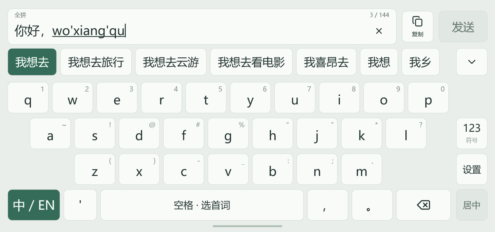

# Sylva

Sylva 是为 VRChat 做的 SteamVR 悬浮键盘。它支持中文全拼、上屏后的词语联想和英文单词补全，通过 OSC 把文字发到聊天气泡。输入和联想都在本机完成。



## 使用

1. 在 GitHub Releases 下载 Windows x64 便携包，解压到可写目录，运行 `sylva-vr.exe`。默认静默启动，右键托盘图标可以显示主窗口。
2. 连接 SteamVR，在 VRChat 的动作菜单中打开 **Options → OSC → Enabled**。
3. 双击右手柄 B 键，在面前呼出键盘。用扳机点键，点「发送」发到聊天框。指向面板并按住握把约 0.15 秒即可拖动，松手会摆正轻微歪斜。

中文模式按空格选首词。英文模式点候选补全，按空格保留原文。要改草稿，直接点输入栏中想修改的位置。

在「设置 → 翻译」开启「发送时翻译」，选择原文语言及一到两种译文。服务按「免 Key 在线」「机器翻译 API」「大模型 API」「本地 / 自建」分组，默认关闭翻译，默认服务为 Microsoft Edge。

选择需要配置的服务后，点「配置 API」。桌面和 VR 使用同一张表单。密钥可一键粘贴，其他字段可用手柄键盘或实体键盘编辑。点「保存」写入当前 Windows 账户的凭据管理器。本地模型可选 Ollama、LM Studio、llama.cpp 或自定义兼容接口，模型 ID 填本地服务实际加载的名称。

按发送后，Sylva 才会将该句交给选定的翻译服务。原文和译文按设置顺序各占一行，合计最多 144 个 UTF-16 单元。等待时可以输入下一句。翻译失败或合计超长时保留原文，若正在编辑下一句，可在草稿空白后点「取回上条」。

开启「防止游戏误触」后，在键盘上按下的扳机会由 Sylva 接管到松手，射线可以移出面板。此功能需在 SteamVR 开发者设置里启用 **Experimental overlay input overrides**。

## 构建

在 Windows x64 安装 Rust 稳定版（MSVC）、Visual Studio C++ 构建工具和 Windows SDK。打包需要 Python 3.11 或更高版本。在仓库根目录运行：

```powershell
powershell -ExecutionPolicy Bypass -File .\scripts\fetch-assets.ps1
python scripts/package.py
```

便携包生成在 `dist/`。脚本会下载并校验水杉词库，OpenVR 运行库和联想模型已随源码提供。

## 许可

Sylva 自有代码和素材采用 [MPL-2.0](LICENSE)。水杉词库、模型和其他第三方组件保留各自许可，见[第三方声明](THIRD_PARTY.md)。
